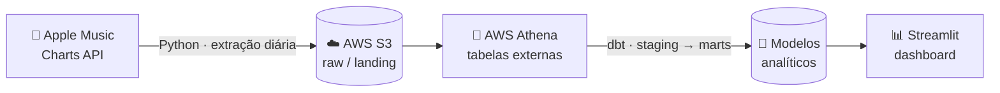

<!-- ============================================================ -->
<!--  Header                                                       -->
<!-- ============================================================ -->
<p align="center">
  
</p>

<p align="center">
  
</p>

<p align="center">
  <a href="https://www.linkedin.com/in/caio-leimig-rodrigues-da-silva/" target="_blank"></a>
  <a href="mailto:caiolrs2005@gmail.com"></a>
  <a href="https://github.com/caioleimig" target="_blank"></a>
</p>

<br />

## Sobre

Estudante de Ciência da Computação na **CESAR School** (Recife, PE), construindo carreira em **Engenharia de Dados** e **Análise de Dados**. Meu interesse está no caminho que o dado percorre: da extração na fonte até virar uma tabela limpa, modelada e pronta para consulta. Gosto de pensar em ingestão, transformação, modelagem e qualidade — e de entregar isso como pipelines reprodutíveis, não como scripts soltos.

Hoje trabalho principalmente com **Python** e **SQL**, usando **AWS** (S3 + Athena) e **dbt** para montar fluxos ELT de ponta a ponta, sem deixar de lado a base de engenharia de software que vem da graduação.

```sql
-- models/marts/dim_developer.sql
SELECT
    'Caio Leimig'                                        AS nome,
    'Data Engineering'                                   AS role,
    'B.Sc. Ciência da Computação @ CESAR School'         AS formacao,
    'Recife, PE — Brasil'                                AS base,
    ARRAY['ELT pipelines', 'Modelagem de dados', 'SQL']  AS foco,
    ARRAY['dbt', 'AWS', 'Orquestração de pipelines']     AS aprendendo_agora
FROM {{ ref('stg_cesar_school__students') }}
WHERE curiosidade > 0
  AND cafe IS NOT NULL;
```

## Projeto em destaque — Global Music DNA

Pipeline **ELT diário** que coleta os charts do Apple Music em **30 países**, armazena o dado bruto em um data lake na AWS, transforma com dbt e expõe os resultados em um dashboard — construído de ponta a ponta como projeto de portfólio.



<sub>Decisão de projeto: a fonte original era a API do Spotify; após problemas de autenticação, migrei a ingestão para a API pública de charts do Apple Music sem alterar o restante do pipeline.</sub>

## Projetos

| Projeto | Visão geral |
| :-- | :-- |
| **Global Music DNA**<br /><sub>Python · AWS S3 · Athena · dbt · Streamlit</sub> | Pipeline ELT diário sobre os charts do Apple Music em 30 países: ingestão em Python, data lake no S3, consultas via Athena, transformações modeladas em dbt e visualização em Streamlit. |
| **Autocar BD**<br /><sub>Java · JavaFX · MySQL · JDBC</sub> | Sistema de gestão de locação de veículos, feito em trio para Modelagem de Banco de Dados: modelo relacional próprio, cadastro de clientes e veículos, registro de locações e devoluções e consulta de histórico persistido em MySQL. |
| **[rota](https://github.com/gabrielfranca10/rota-fccpd)**<br /><sub>Python · threads · stdlib</sub> | Núcleo de despacho de pedidos de delivery com concorrência baseada em threads, usando só a biblioteca padrão. Projeto em equipe de Computação Concorrente, Paralela e Distribuída, com roadmap de quatro entregas. |
| **EDA — Online Food Delivery**<br /><sub>Python · Pandas · Google Colab</sub> | Análise exploratória do Online Food Ordering Dataset (Kaggle): limpeza, perfil das variáveis, distribuições e relações entre atributos de clientes e pedidos. |

<details>
<summary><b>Mais trabalhos</b> — jogos e disciplinas de base</summary>
<br />

- **[Frevo Runner](https://github.com/yan791/Frevo_Runner)** — endless runner inspirado no Carnaval de Olinda, em C com Raylib. Atuei em refatoração do código, fluxo de Git da equipe e apresentação.
- **Cosmic Blaster** — jogo em C/Raylib feito em trio para Programação Imperativa e Funcional, aplicando listas encadeadas, matrizes e modularização em funções.

</details>

## Stack técnica

| Área | Tecnologias |
| :-- | :-- |
| **Linguagens** |     |
| **Dados & Análise** |     |
| **Engenharia de Dados & Cloud** |     |
| **Bancos de dados** |   |
| **Ferramentas** |     |

## Objetivo

Atuar como **Engenheiro de Dados**, projetando pipelines confiáveis, modelando dados para análise e garantindo que a informação chegue limpa, documentada e no tempo certo a quem precisa dela.

## GitHub Analytics

<p align="center">
  
  
</p>

<p align="center">
  
</p>

<!-- ============================================================ -->
<!--  Footer                                                       -->
<!-- ============================================================ -->
<p align="center">
  
</p>
